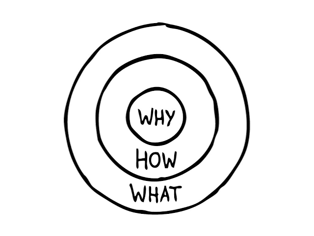
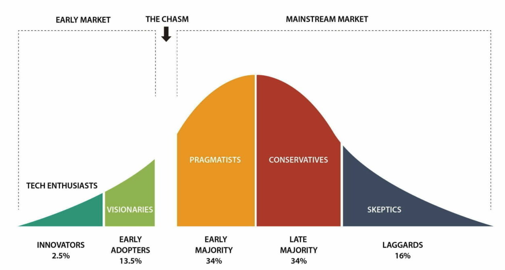

## Golden circle, Chasm marketing

<table>
    <tr>
    <td width="50%">
        
    </td>
    <td width="60%" valign="">
        <strong><em>"사람들은 당신이 '하는 일'을 구입하지 않는다. 당신이 '믿는 일'을 구입하는 것."</em></strong>

    Why → 존재 이유, 목적, 신념, 가치관
    How → 신념을 실행하기 위한 방법, 과정
    What → 실제 제공하는 제품, 서비스 등 결과물
</table>

| 일반적으로 소통하는 방식 | 영감을 주는 소통 방식 |
|---|---|
| 우리는 아주 훌륭한 컴퓨터를 만듭니다.(what) 세련된 디자인에 사용하기 쉽죠(How). 하나 사실래요? | 우리가 하는 모든 일은 기존의 현상에 도전하고, 다르게 생각하는 것(Why)을 믿습니다. 우리의 방식은 아름답게 디자인되고 사용하기 쉬운 제품을 만드는 것입니다(How). 우리는 그렇게 훌륭한 컴퓨터를 만들게 되었습니다(What). - apple |

- 골든 서클은 뇌의 구조와 닮아있다.
    - Why: 감정, 신뢰, 충성도를 담당하는 뇌 영역(변연계)를 자극함.
    - What: 언어와 분석을 담당하는 신피질에 머뭄.

- 내가 하는 일은 나의 신념을 비춘다.
    - 리더의 신념을 함께 믿는 사람들은 충직한 구성원이 될수밖에 없는 이유.

>💡 사람들은 내가 무엇을 하는지가 아니라, 왜 그것을 하는지를 보고 동요한다.

---
### Chasm - 깊고 넓은 틈(단절)

- 신기술, 혁신적인 제품과 서비스가 일반 대중에게 받아들여지기 전 존재하는 간극.

- 유형에 따른 특징

| 유형 | 특징 | 예시 |
|---|---|---|
| 혁신가 | 새로운 기술을 가장 먼저 경험하고 싶어 함 | 신기술을 직접 테스트(얼리테스터) |
| 얼리어답터 | 제품의 가능성과 미래 가치를 중요하게 생각함 | 초기 서비스 적극 이용 |
| 전기 다수 수용자 | 검증된 제품을 실용적으로 사용하고 싶어 함 | 주변의 추천과 리뷰를 보고 구매 |
| 후기 다수 수용자 | 대중적으로 보편화된 후에 사용함 | 대부분의 사람이 사용하면 도입 |
| 지각 수용자 | 기존 방식을 선호하고 새로운 기술 도입이 늦음 | 기존 제품을 계속 사용 |
 

- 캐즘 마케팅의 핵심 전략
    - 일반 대중 대상
        - 실질적인 편리함 강조
        - 사용 후기와 신뢰성 강조
        - 실제 문제 해결 사례 제시
        - 가격과 사용 편의성 강조
    - UX와 캐즘 마케팅 
    : 새로운 기능이나 복잡한 인터페이스를 배우는데 거부감이 생길 수 있음.
        - 사용성 개선: 누구나 쉽게 기능을 이해하고 사용할 수 있도록 설계하기.
        - 온보딩 제공: 처음 사용하는 사람도 쉽게 적응하도록 안내하기.
        - 진입 장벽 감소: 복잡한 가입 및 설정 절차 간소화.
        - 신뢰성 확보: 오류를 줄이고 안정적인 사용 경험 제공.
        - 가치 전달: 제품을 통해 어떤 문제를 해결 가능한지 명확하게 전달.

> ⭐️ 초기 사용자층과 일반 대중 사이의 심리적, 기술적, 경제적 장벽을 극복해 제품을 대중화하는 전략