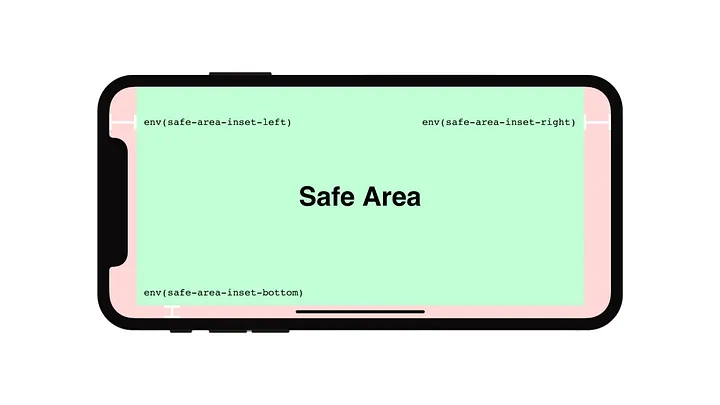

## 1. 그리드 시스템과 4/8배수 간격
> 컬럼, 거터, 마진으로 그리드를 설명할 수 있다. 
간격을 4/8 스페이싱 스케일로 통일할 수 있다. 
Auto layout 간격과 패딩을 스케일 값으로 설정할 수 있다.

- 그리드: 요소들을 정렬하기위한 화면의 보조선
    - Column 컬럼: 내용이 놓이는 세로 칸 (ex. 모바일 4개, 데스크탑 12개)
    - Gutter 거터: 컬럼의 간격 (ex. 모바일 16, 데스크탑 24)
    - Margin 마진: 화면 끝 여백 (ex. 모바일 16, 데스크탑 80)

- 4/8배수 간격과 아이콘
    - 4/8배수로 만든 디자인 수치 x 기기 배율 = 실제 픽셀 
    : 어느 배율에서도 정수로 딱 떨어짐. 
    ex. 피그마 13px @1.5x = 19.5px -> 소수점 단위가 선명도를 떨어뜨림.

- 스페이싱 스케일: 사용할 간격 값을 미리 정해둔 목록. 
    ex. 4→아이콘과 글자, 12→라벨과 입력칸, 24→카드/묶음 사이 
    → 굴곡도 4의 배수로 값을 지정해 사용함.
    - 간격 정하는 순서: 가장 작은 요소부터 바깥쪽으로. 가까운 것은 좁게, 다른 묶음은 넓게
    - 피그마 개발 모드에서 개발자들도 값을 바로 확인하므로 스케일을 적용해 디자인한다.

## 2. 스크린 사이즈와 브레이크포인트
> 해상도(px)와 논리 단위(pt, dp)를 구분할 수 있다. 
대효 화면 크기와 브레이크 포인트를 설명할 수 있다. 
한 화면을 모바일/태블릿/데스크탑 레이아웃으로 바꿀 수 있다.

- Logical Units (논리 단위) = UI의 크기를 정의하는 기준 
→ 화면의 실제 점(픽셀)의 수는 기기마다 다름. 
→ 화면의 크기가 동일해도 해상도에 따라 픽셀 단위가 변경 
(화질이 높을수록 화면이 더 선명함. 1080px → 1440px) 
→ 논리 단위는 OS별 명칭만 다를 뿐, 수치값은 동일함.

    - Platform-specific Logical Units

    | 사용하는 곳 | 단위 | 뜻 |
    |---|---|---|
    | iOS | px(픽셀) | 화면을 구성하는 단위 |
    | Android | pt(포인트) | 논리 단위(Point) |
    | 웹(CSS), 이미지 파일 | dp (Density-independent Pixel) | 160dpi 화면을 기준으로 한 논리 단위 |

- 배율 = 실제 디스프레이 픽셀로 표현하는 비율(@1.5x, @2x, @3x) 
: 동일한 UI 크기를 유지하면서 디바이스의 픽셀 밀도에 맞춰 더 많은 물리적 픽셀을 사용하는 것. 
ex. UI 크기가 100px인 버튼 → @1.5x = 150px, @3x = 300px

- Figma ⇒ @1x 기준으로 디자인(px) 
: 예를 들어 iOS 화면의 버튼 너비가 343pt라면, 피그마에서도 343px 크기로 디자인하고 개발 시 iOS의 Point 단위에 맞춰 구현함. 
    *→ 에셋을 별도로 전달해야 하는 경우 <ins>이미지, 아이콘(**SVG**)</ins>은 **최소 3배율(@3x)로 export.***

    > 💡 에셋을 배율로 내보내는 이유는 픽셀 밀도가 다른 디스플레이에서도 동일한 시각적 크기와 선명도를 유지하기 위함임.

- 화면 크기: 점유율이 많은 디바이스를 기준으로 함.(유동적) 
→ [국가별, OS별, 모바일별 화면 해상도 점유율을 확인 사이트](https://gs.statcounter.com/screen-resolution-stats/mobile-tablet/south-korea?utm_source=chatgpt.com) 
→ [화면 너비별 디바이스 분포 확인](https://screensizemap.com/?utm_source=chatgpt.com) 
    

        
디자인 진행 순서

        1. 한국 모바일 화면 크기 점유율 확인. 
        2. iOS와 Android 대표 디바이스 크기 각각 선정. 
        3. Figma에서 논리 단위로 프레임 구성. 
        4. 가장 작은 화면에서 레이아웃이 깨지는지 검증. 
        *→ 대표 프레임을 정하는 것은 디자인 생산성을 위한 기준이며, 최소 화면 크기는 레이아웃 안정성을 위한 기준!*
    

- 브레이크 포인트: 레이아웃이 전환되어야 하는 지점(가로 폭) 
    → 사용자 디바이스 점유율과 서비스 특성을 근거로 팀 내 반응형 전환 기준(Breakpoint)을 정의하고, 공통 디자인 원칙으로 삼아 작업함! 
    ex. 모바일: 0~767px(1 Column), 태블릿: 768~1023px(2 Columns), 데스크탑: 1024px 이상(Multi Column)

- 바뀌는 패턴: 화면이 넓어질 때 자주 쓰는 4가지 
    1. 열 수 바꾸기: 목록이 1열 -> 2열로 바뀜
    2. 내비게이션 바꾸기: 하단 탭에서 옆 레일/사이드바로 변경
    3. 보조정보 보이기/숨기기
    4. 최대 폭 제한: 데스크탑 화면의 가로폭대로 정보가 퍼지면 파악하기 힘듦.

## 3. iOS, Android, Web 디바이스 별 유의점
> Safe Area와 시스템 영역을 고려해 화면을 구성할 수 있다. 
iOS 와 Android의 큰 차이점은?

- iOS 와 Android 같은 기능, 다른 규칙 
→ 안드로이드는 시스템 상 뒤로가기 버튼이 존재해 만들지 않았었으나, 다른 운영 체제(iOS) 사용자를 고려해 화살표가 추가됐다. 
→ 안드로이드: 웹 접근성을 중요시 생각. 
→ iOS는 뒤로가기 버튼을 누를 경우, 이동하게 될 화면의 이름을 적어두기 때문에 제목이 가운데 위치함.

    | 항목 | iOS(Apple HIG) | Android(Material 3) |
    |---|---|---|
    | 단위 | pt(포인트) | dp(디피) |
    | 기본 서체 | SF Pro · 한글 Apple SD 산돌고딕 Neo | Roboto · 한글 Noto Sans CJK |
    | 하단 메뉴 | 탭 바 (Tab Bar) | 내비게이션 바 (Navigation Bar) |
    | 뒤로 가기 | 왼쪽 위 ' **<** ' 버튼, 왼쪽 화면 끝 스와이프 | 시스템 뒤로가기 (제스처, 버튼) |
    | 최소 터치 영역 | 44x44pt | 48x48dp |

- 시스템 영역의 종류
    - Safe Area 안전 영역 
        : 상태바, 다이내믹 아일랜드, 노치, 홈 인디케이터 등 시스템 UI와 겹치지 않게 확보하는 영역. 
        (iOS: Safe Area Insets, Android: Window Insets) 
        
    - 키보드: IME Insets - 키보드가 화면에 나타났을 때 높이를 감지하는 영역
    - Bottom CTA/Sticky Button - 화면 하단에 고정된 메인 버튼. 
    : 키보드가 올라오면 키보드 바로 위로 버튼을 이동시키는 UI 패턴
    - 제스처 영역: 홈 인디케이터, 뒤로가기 스와이프

    > 💡 핵심 용어 정리

        - 시스템 영역 대응: Safe Area Insets
        - 키보드 영역 감지: Keyboard Insets (IME Insets)
        - 하단 버튼 고정: Sticky Bottom CTA
        - 화면 영역 자동 조정: Resize / Insets-based Layout

- Web 화면 디자인할 때 신경써야할 점.
    - Hover & Focus: 모바일에는 존재하지 않지만 웹에서 기능하는 상태 값. 
    → Focus 상태는 버튼 바깥 라인(line)이 항상 존재해야함.

> 최종 요약

    간격은 4/8배수 스케일 안에서, 가까운 것은 좁게 묶는다.
    디자인은 각 OS별 논리 단위로, 레이아웃은 화면 폭 구간별로 바꿈(브레이크 포인트)
    OS 규칙과 Web 상태(Hover, Focus) 잊지않고 잘 챙기기

---

- [실시간 실습](https://www.figma.com/design/uEVcMFnERuCLrQliZDqY6d/5%EC%A1%B0---%EB%AC%B4%ED%99%94%EA%B3%BC-4---UX-UI-%EC%8B%A4%EC%8B%9C%EA%B0%84-%EC%97%B0%EC%8A%B5--%EA%B9%80%EC%A7%80%EC%9C%A0-%EA%B9%80%ED%98%84%EA%B2%BD-%EA%B9%80%ED%98%84%EC%A7%80-?node-id=4088-222&t=GAVlU0uHkvkiXz4k-1) 
    
    → 하면서 느낀 점
    - 오토 레이아웃에서 카드 줄바꿈 정렬은 Toggle Automatic Positioning 
    → Grid 상자 클릭하면 열/행 조정이 직관적으로 가능하다.
    - Grid 옵션이 Stretch면 좌우 늘어난 형태. left/right는 제외할 영역만큼 width/height을 입력해주면 남은 공간에 그리드가 생김.
    - 화면을 구성할 때 정보의 중요도(글, 이미지)에 따라 레이아웃을 설계한다.
    

    
키보드 시스템 영역에 가려지는 버튼의 위치는 디자인 → 개발 단계에서 어떻게 조정하게 될까?
  

    | 구분 | 구현 방식 |
    |---|---|
    | iOS | Keyboard Layout Guide 또는 Keyboard Notifications로 키보드 영역 감지 |
    | Android | WindowInsets로 IME 높이 감지 |
    | React Native | Keyboard 이벤트 및 Safe Area 처리 |

    - 개발팀과 협업 시 요구사항의 예시
        - “Safe Area와 Keyboard(IME) Insets 기반으로 하단 CTA가 키보드 상단에 동적으로 고정되도록 구현해주세요” 
    → 또한, 키보드가 올라왔을 때 버튼만 위로 이동하는지 버튼과 콘텐츠 전체가 함께 재배치될지도 고려할 것.
        - 예시1. CTA만 이동 - 콘텐츠는 그대로 유지하고 하단 버튼만 키보드 위로 이동
        - 예시2. 화면 전체 Resize - 키보드가 올라온 만큼 앱 콘텐츠 영역 전체를 축소하고 CTA도 하단에 위치
        - 예시3. Scroll 방식 - 콘텐츠 스크롤이 가능하고 CTA는 키보드 위에 고정시킴
    
